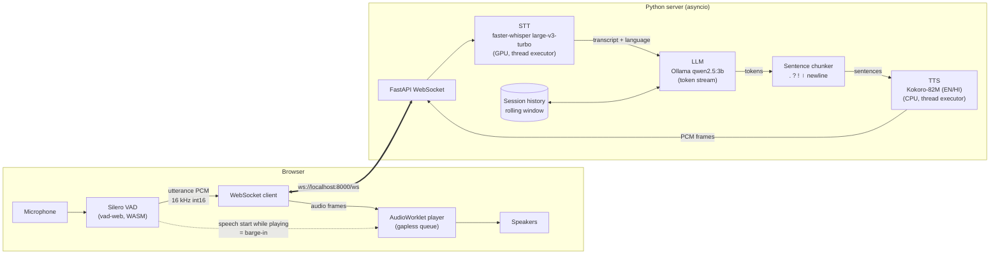
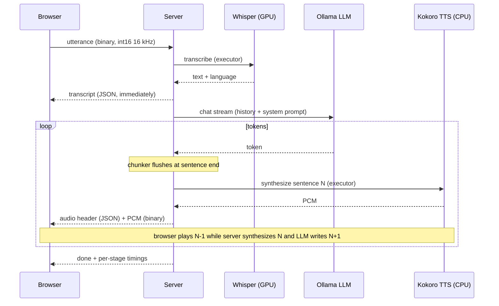

# Architecture

Everything runs locally. The browser does voice-activity detection; the Python server does STT, LLM and TTS.

## Streaming pipeline (one turn)

## Barge-in

1. VAD fires `onSpeechRealStart` while audio is playing (or a turn is in flight).
2. The playback worklet is flushed instantly; it reports which sentence was playing and how far.
3. Client sends `{"type":"interrupt","turn":T,"sentence":i,"fraction":f}`.
4. Server cancels the turn task. Cancelling closes the HTTP stream to Ollama (generation stops) and drops queued TTS work.
5. `Session.apply_interrupt` rewrites the assistant message to **only what was spoken** (earlier sentences + a word-boundary cut of the current one). Nothing spoken -> the assistant message is dropped.
6. Server acks with `{"type":"interrupted"}`; the next utterance proceeds normally.

## Memory discipline (8 GB machine)

* One STT, one LLM (inside the Ollama process), one TTS model, all loaded once at startup and shared by every session.
* STT and TTS run in single-thread executors, so there is never more than one inference of each kind in flight.
* Only complete utterances are held in memory (not session audio); history is capped by turns *and* an estimated token budget, and trimmed turns collapse into a one-line "earlier topics" note.

## WebSocket protocol

| Direction | Message | Meaning |
|---|---|---|
| C -> S | binary | one utterance, int16 mono 16 kHz |
| C -> S | `{"type":"interrupt","turn","sentence","fraction"}` | barge-in with playback progress |
| C -> S | `{"type":"reset"}` | clear conversation |
| S -> C | `{"type":"ready", ...}` | models loaded |
| S -> C | `{"type":"transcript","text","language"}` | STT result |
| S -> C | `{"type":"audio","turn","index","text","sample_rate"}` + binary PCM | one synthesized sentence |
| S -> C | `{"type":"done","timings":{...}}` | turn complete + latency breakdown |
| S -> C | `{"type":"interrupted"}` | barge-in acknowledged |
| S -> C | `{"type":"error","message"}` | failure |
